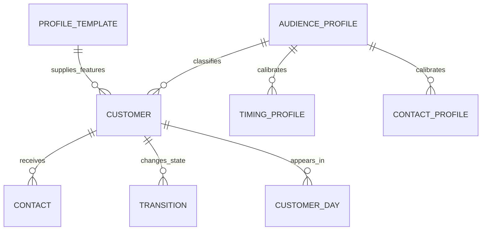

# Historical Customer Lab specification (v1)

Superseded by `docs/retail-customer-construction.md`. The current app uses mission-defined retail groups, a rebuilt CRM warehouse and one continuous scrolling page. The material below records the earlier response-stage prototype.

Built November 17, 2026. The product supports customer exploration and advertising-policy scenarios for a fictional retailer.

## Full default sample

Generation seed: 171126. Starting customers: 100,000. Campaign: 28 days. New customers: 15% of starting population per week, totaling 60,000. Contact capacity: 150,000. Top 25% of the active base eligible, six-contact campaign cap, 65% preferred repeat allocation, 10% weekly turnover and 8% weekly inactive return.

Default generated warehouse:

- 160,000 customer rows.
- 150,000 contact events.
- 173,501 net daily state changes.
- 3,877,251 customer-day snapshots after arrival, including day-zero starting customers.

These counts are reproducible for the default scenario; changed controls generate a new live scenario. The default data on disk is not overwritten by interactions.

## Source calibration

`scripts/prepare_customer_lab.py` reads the earlier actual-data exploration and creates a small portable bundle in `app/data/customer_lab/`:

- `audiences.parquet`: five feature-defined uplift groups, population shares, control conversion rates, incremental rate differences and source counts.
- `timing.parquet`: fourteen-day response CDFs from propensity-matched held-out attribution histories, with history/event support.
- `frequency.parquet`: fraction of recorded response paths covered by a given pre-conversion contact count, by matched group.
- `arrivals.parquet`: observed cumulative campaign audience arrival curve over 28 days.
- `profile_bank.parquet`: 200,000 reproducibly sampled source-feature templates and constructed business metadata.
- `provenance.json`: dataset scope, seed and assumptions.

Five profile rules are the first matching condition, where "active" means a categorical feature differs from its most frequent exact training-sample token:

1. f8 not active → Discovery audience.
2. f9 not active → Light browsers.
3. f4 not active → Researchers.
4. f11 not active → Decision-stage.
5. Remaining records → High intent.

The rules are applied in order. Exact mode tokens are retained in `outputs/metadata_exploration/rules.json`. The names are fictional interpretations; Criteo's original feature semantics are unknown. Metadata includes an engagement-style interpretation, shopping need and proposed message theme. No real demographic or creative efficacy is inferred.

The propensity-matching construction and its sensitivity are documented in `docs/campaign-duration-concept.md`. Lower/higher propensity populations in separate releases are matched by rank and group proportions. A synthetic segment key joins summaries. There is no claimed shared user ID.

## Table relationships

Actual join keys:

- `customers.customer_id` is unique and generated, not a Criteo uid.
- `source_row_index` links to a template's zero-based row in the local uplift parquet. Source templates are sampled with replacement to create new fictional customers. This is lineage, not source identity linkage.
- `segment_id` joins customer profiles to the five aggregate calibration profiles.
- `contacts`, `transitions` and `customer_states` reference `customer_id`.
- `contacts` has at most one row per customer per day. `contact_number` is cumulative and never exceeds the chosen campaign cap.
- `transitions` records the state at the start and end of the simulated day when those states differ. Intraday steps are not separate events.
- `customer_states` records state and cumulative contacts for each entered customer each day. Future arrivals have no warehouse snapshot until arrival; the in-memory flow model retains an explicit "Not arrived" state for conservation.

## Static profiles versus changing states

A profile describes the customer's underlying source-derived response pattern and remains fixed. Lifecycle state is separate:

- New: entered the simulated active pool.
- Engaged: exploring.
- Ready: progressed toward a purchase decision.
- Responded: generated an organic or ad-driven response; no further ads in this campaign.
- Inactive: left the active pool.
- Returning: came back after inactivity; becomes engaged the next day unless another transition intervenes.
- Not arrived: only the internal representation of a scheduled future customer.

Initial lifecycle mixtures depend on profile but are synthetic. New entrants always start in New. Daily New → Engaged probability is 1.8% plus 12 percentage points on a contacted day. Engaged → Ready is 1.2% plus 8.5 points on a contacted day. These illustrate movement; they do not change the separately calibrated conversion probability.

That separation matters: a profile does not become a different Criteo-derived group because its customer enters the Ready lifecycle state. The UI keeps profiles and states distinct.

## Advertising allocation

Daily capacity is the difference between successive integer fractions of the total budget, so all daily quotas sum exactly to the campaign budget.

Rank the current active population by its profile's benchmark increment and select the top chosen percentage. Use a stable customer-ID hash to break ties. Then enforce the cap. Keeping the eligible pool definition before the cap is intentional: if a narrow pool has exhausted its caps, the policy does not silently expand into other customers.

Allocate the requested repeat fraction to previously contacted customers and the remainder to fresh customers. If one pool is short, fill from the other. At most one contact per customer per day. Unavailable daily capacity remains unused and expires. Responded and inactive customers are ineligible. Returning customers retain their cumulative contact count.

The preferred repeat percentage may differ from the delivered repeat percentage; the latter appears in the metrics and comparison table.

## Turnover, arrivals and return

Weekly probabilities are converted to daily probabilities by `1 - (1 - weekly_rate) ** (1/7)`. Newly arriving and just-returned customers do not immediately turn over again on the same day. Responses are not erased when audience membership changes.

Total new entrants equal `starting_population × weekly_arrival_rate × campaign_days/7`, rounded to an integer. They are distributed across campaign days in the shape of the observed Criteo arrival curve. The arrival rate is a user assumption; the curve only supplies a timing shape.

Turnover moves customers to Inactive and does not delete their identity or history. Returning customers are the same IDs, not new arrivals. The cohort heatmap uses the customer's original arrival cohort.

## Generated outcomes

Every customer receives two seeded uniform probability thresholds: one for organic response and one for additional campaign response. With age capped at fourteen days:

`organic cumulative probability = profile control rate × matched response-time CDF(age)`

`campaign cumulative probability = profile incremental rate × matched response-time CDF(age) × contact coverage(contact_count)`

With no contacts, campaign probability is zero. With additional contacts, coverage rises with diminishing increments. Contact coverage is interpolated between empirical counts. When an eligible active customer's threshold is crossed, a response is generated and the customer leaves the advertising pool. Organic responses are generated first and counted separately, so no customer is counted in both categories.

These generated response labels are simulation bookkeeping, not individual causal labels inferred from randomized data. Multiplying timing and contact coverage assumes a separable response surface. It differs from the earlier research script's full-path replay. The two-week benchmark calibration is not a guarantee of exact population effects in a 28-day synthetic lifecycle.

The simulator is seeded and reproducible. Strategy comparisons use the same population, threshold draws and environment, but allocation and state trajectories can diverge. Small differences between strategies are not statistical evidence.

## UI and interpretation

The current app is a five-section presentation: the client question, audience introduction, response patterns, campaign simulation and the answer. Back/Next and the main-page section selector control the sequence. The sidebar is exclusively a placeholder for the future Gemini chat. No Gemini API or generated AI responses have been implemented.

Audience bars show fixed benchmark group proportions. Group labels are constructed metadata. Timing curves are normalized to recorded fourteen-day responses, and repeated-contact curves show historical path coverage. Historical evidence does not change when the simulation environment changes.

The main-page campaign form independently sets the eligible profiles, contact cap and repeat preference for two campaigns. Both use the same customer IDs, profile assignments, arrival cohorts, seeded response thresholds, environment and available budget. The optional backend breadth parameter remains available, but the presentation uses breadth 100% within each selected set of profiles. Empty sets are rejected in the UI.

Submitted settings are retained across story sections. After a run is prepared, settings collapse and a timed Streamlit fragment advances the two histories and the cumulative ad-response chart together. Pause/resume, single-day advance, replay, final-day jump and speed are provided. Navigating away pauses playback.

Customer animations use a shared fixed trace sample, with eventual responders deliberately emphasized for visibility. The display explicitly labels this; dot proportions must not be interpreted as population proportions. SVG positions are meaningful zones: unreached, reached, all responses, and inactive. Contact pulses and position interpolation illustrate each day's changes. Organic and campaign responses both appear in movement, while the ad-driven metrics and chart exclude organic responses. Numeric totals use the entire synthetic population.

The final answer uses the submitted run, reports both outcomes and unused capacity, and describes differences as scenario results rather than a validated winner. Source construction and model assumptions remain accessible through a compact About popover and the final expander rather than repeated explanations beside every chart. The original cohort/flow chart builders remain available in the code, but are not separate top-level presentation screens.

## Validation

`python -m unittest tests.test_customer_lab -v` checks deterministic histories, capacity/cap constraints, one-contact-per-day, profile eligibility, contact foreign keys, no pre-arrival contacts, monotone cumulative contacts, zero-budget behavior, turnover impact and flow conservation.

`python scripts/check_customer_app.py` exercises the story sections, confirms no campaign controls are in the sidebar, and checks the configured pair, shared IDs/budget, playback controls, navigation persistence, answer, empty-group validation and zero-budget behavior. AppTest requires local event-loop sockets. The browser preview is additionally checked for actual chart and animation rendering. SVG traces use the supported iframe renderer because sanitized HTML strips inline SVG.

Previous segmentation functionality is preserved at `app/legacy_app.py`. The old `scripts/check_streamlit.py` points at that legacy entry point.
